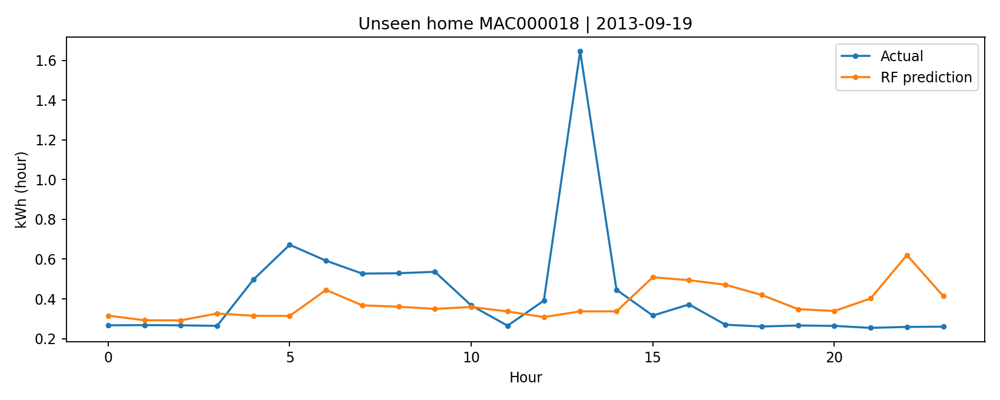
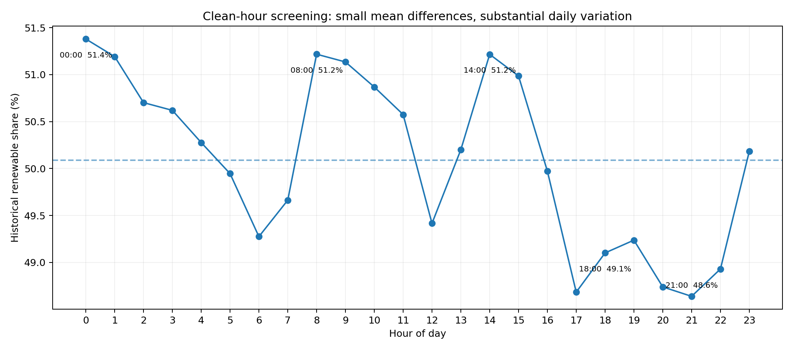

# Day-Ahead Household Electricity Forecasting and Cost-Aware Energy Planning — SDG 7

## Project overview

This project studies **next-day hourly household electricity forecasting** and explores how forecasts can support **cost-aware electricity consumption planning** under Turkish time-of-use tariffs. It extends an initial single-household Random Forest study with unseen-household evaluation, a weather-feature experiment, Turkish residential tariff scenarios, and historical renewable electricity generation analysis.

The work contributes to **SDG 7 (Affordable and Clean Energy)** and explores an additional connection to **SDG 13 (Climate Action)**. The scheduling results are **illustrative simulations**, not measured bill savings or a deployed optimization service.

## Team — Group 7

- Burak Arslan — 22061025
- Buğra Karatepe — 22061032
- Zeynep Erva Akdoğan — 22061049
- Zeynep Şura Çetin — 22069030

## What was added after the initial study?

| Module | What was implemented | Data / scope |
|---|---|---|
| Multi-household evaluation | Random Forest tested on households absent from training | London Smart Meters subset |
| Weather experiment | With/without historical weather features, evaluated on the same test households | London electricity + weather |
| Tariff simulation | Estimated consumption cost and assumed flexible load-shifting scenarios | Initial French forecasts + dated Turkish EPDK tariff |
| Renewable-energy analysis | Hourly historical generation mix and renewable-share profiles | EPİAŞ-origin data republished by EnerjiVeri |

The **London unseen-household experiment** is the main expansion of the forecasting evaluation. The **original French dataset remains only as the initial baseline and the input to the tariff simulation**; it is not presented as the data behind the London results.

## 1. Multi-household forecasting — London Smart Meters

A sample of **1,000,000 half-hourly records** covering **30 household IDs** was inspected. After requiring sufficient valid hourly history, **12 households** were eligible for evaluation. A group- and time-aware split used **9 households for training** and **3 entirely unseen households for testing** (11,495 test observations).

| Forecasting method | MAE (kWh) | RMSE (kWh) |
|---|---:|---:|
| **Random Forest** | **0.2026** | **0.3401** |
| Previous-day baseline | 0.2306 | 0.4247 |
| Previous-week baseline | 0.2404 | 0.4259 |

Random Forest's MAE was about **12.1% lower** than the previous-day baseline on the held-out households. These results demonstrate performance on **three** unseen homes in this limited subset, not across every London household.

## 2. Weather-feature comparison

Two Random Forest configurations were compared on the same London test observations. The weather-enhanced model used **previous-day historical weather measurements**, rather than assuming the next day's realized weather was already known.

| Features | MAE (kWh) | RMSE (kWh) |
|---|---:|---:|
| **Consumption/history features only** | **0.20268** | **0.34070** |
| Consumption/history + weather | 0.20565 | 0.34207 |

In this experiment, adding the selected weather variables **did not improve** the error metrics. This is a useful negative experimental result, not evidence that weather never matters.

## 3. Turkish electricity tariffs and load-shifting scenarios

The initial French-household forecasting outputs were paired with an **EPDK Turkish residential time-of-use tariff snapshot dated 4 April 2026**. The study evaluates hypothetical shifts of flexible peak-period consumption to lower-priced hours.

| Assumed share of flexible peak-period load | Simulated cost reduction |
|---|---:|
| 10% | 559.15 TL (2.04%) |
| **20%** | **1,110.63 TL (4.05%)** |
| 30% | 1,445.33 TL (5.27%) |

For the 20% scenario, modeled cost decreased from **27,412.53 TL** to **26,301.90 TL** across **216 selected complete evaluation days**. These days are **not a continuous billing period**. The simulated load flexibility was not measured at the appliance level. The French electricity consumption records and 2026 Turkish tariffs come from **different countries and years**, so these figures are **not actual household bills or verified savings**. Any real tariff comparison must also account for the subscriber's applicable tariff and bill components.

**Important distinction:** EPİAŞ day-ahead wholesale market prices (PTF) are **not** the same as the residential tariff used in a household electricity bill. Residential time-of-use cost scenarios use EPDK prices, not PTF as a substitute.

## 4. Electricity generation and historical cleaner-hour analysis

An EPİAŞ-origin hourly generation archive **republished by EnerjiVeri** was analyzed for **30 complete days (30 September–29 October 2026; 720 hourly records)**. Renewable generation share was calculated from hydroelectricity, wind, solar, geothermal and biomass categories relative to the listed generation-source total.

- Highest average historical renewable share: **00:00 — 51.38%**.
- Another relatively high hour: **08:00 — 51.22%**.
- Lowest average historical renewable share: **21:00 — 48.64%**.

An **illustrative** two-hour, 1.2-kWh activity moved from 18:00–20:00 to 00:00–02:00 produced an estimated **3.88 TL energy-charge difference** under the dated EPDK active-energy prices and a **2.12 percentage-point difference** in the corresponding historical average renewable shares. This is **not a real appliance experiment**, a verified forecast of tomorrow's generation mix, or a quantified CO2 saving.

## Project distinction and contributions

Rather than targeting only the next hour's demand, this project focuses on **day-ahead hourly forecasts** and connects forecasting outputs to **tariff-aware cost scenarios**. Its contributions are:

1. Evaluation on previously unseen household IDs.
2. A controlled weather-feature comparison.
3. Transparent Turkish residential electricity cost scenarios.
4. Historical generation-mix analysis supporting sustainability-oriented scheduling discussions.

A full user-facing tool and appliance-constrained mathematical optimization model **have not yet been implemented**.

## Repository structure

| Directory / file | Contents |
|---|---|
| `SDG7 Assignment1/` | Original UCI France single-household forecasting study, notebook and outputs |
| `01_EPDK/` | Tariff snapshot, cost calculations, scenarios and charts |
| `02_London_Household_HeldOut/` | London unseen-household experiment, notebook, metrics and example forecast |
| `03_Weather_Comparison/` | Weather-feature experiment, predictions and evaluation |
| `04_EPIAS_Renewable_and_Scheduling/` | Generation-source analysis, scenario files and charts |
| `README_TR.md` | Turkish-language explanation and methodology notes |

Each experiment folder contains available scripts/notebooks, generated outputs and methodological notes. See the corresponding files for data-specific assumptions and reproduction details.

## Initial baseline — UCI French single-household dataset

The first assignment used the [UCI Individual Household Electric Power Consumption dataset](https://archive.ics.uci.edu/dataset/235/individual+household+electric+power+consumption), representing one household in France during **2006–2010**. Its hourly Random Forest evaluation produced **MAE 0.4205 kWh** and **RMSE 0.5827 kWh**, compared with **MAE 0.5134 kWh** for the previous-day baseline. This was the original proof of concept and remains the source of forecast values used for the tariff scenarios.

**Do not directly compare** the French and London error values as if they came from the same test set; the households, periods and train/test splits differ.

## Limitations and next steps

- Only a small portion of London Smart Meters was analyzed; testing included three unseen households.
- The French baseline, London evaluation and Turkish tariff / generation analyses involve different countries and periods.
- Appliance-specific flexible demand is assumed rather than metered; load shifting is a scenario, not a fully constrained scheduling optimizer.
- Renewable generation *share* is not an estimate of marginal carbon emissions or guaranteed next-day grid cleanliness.
- Next steps include broader cross-household tests, more predictive weather features, appliance-constrained scheduling, validated next-day generation information and an optional user interface.
- Household consumption records may reveal routines and require appropriate privacy safeguards.

## Data sources

- [UCI Individual Household Electric Power Consumption](https://archive.ics.uci.edu/dataset/235/individual+household+electric+power+consumption)
- [London Smart Meters — London Datastore](https://data.london.gov.uk/dataset/smartmeter-energy-consumption-data-in-london-households-vqm0d)
- [EPDK — Electricity tariff tables](https://www.epdk.gov.tr/Detay/Icerik/3-1327/elektrik-faturalarina-esas-tarife-tablolari)
- [EPİAŞ Şeffaflık Platformu](https://seffaflik.epias.com.tr/)
- [EnerjiVeri — Electricity generation archive](https://enerjiveri.com/elektrik/uretim-tarihce/)
- [United Nations — SDG 7](https://sdgs.un.org/goals/goal7)

**Data provenance note:** Historical Turkish generation data were obtained from a third-party archive attributed to EPİAŞ, not directly from the official EPİAŞ download API.
